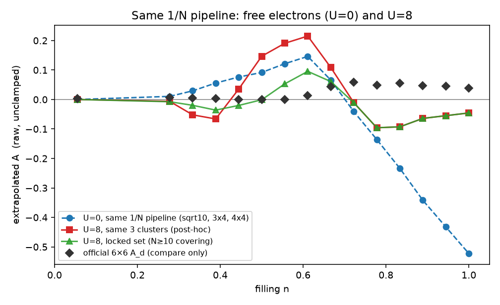

# A validated exact-diagonalization reference check of OSC's pairing estimate

*Draft v2.5, 26 November 2026. Author: Liam Dixon. Not submitted. Code and results: this package.*
*v2 answered a research review (26 Nov 2026). v2.1–v2.3 fixed review items, included the completed 18-site n=0.667 point (reported with and without), restored package reproduce paths, and disclosed that the addendum file was re-saved after that result was known. v2.4 added an optional, off-by-default ED `estimate_pairing()` (`ed_pairing.py`; `OSC_ED_PAIRING=1` to enable). This v2.5 fixes the opt-in wrapper so it writes a labelled ED calibration file, not a mislabelled submission, and keeps default-off output byte-identical to the official script (exit code, stdout, stderr, JSON). The locked analysis rule is unchanged and labelled; new analyses are labelled post-hoc. Addendum: `ed_multisize/PREREGISTRATION_addendum.md`.*

## In one paragraph

The Open Superconductor Challenge (OSC) scores each material as N(E_F) × A_d × 300, where A_d is a
"pairing amplitude" taken from a table computed with an approximate (variational) method on a 6×6 lattice.
We built an exact solver for the same simple model, checked it against an independent published table
(all 27 Ku-ku rows; 29 checks, including two 4×4 fillings run with both of our solvers), added two
larger lattice shapes, and then estimated how the pairing number changes as the lattice grows, following
an analysis plan fixed before any 18- or 20-site result. That size trend, on 10–16-site clusters, has the
**same up-then-down sign pattern for free electrons as for the interacting model**.
Free electrons have a nonzero d-wave background even though they have no pairing order; the *sign
pattern* of the 1/N trend is largely a finite-cluster shell and shape effect. At n ≥ 0.8 the
magnitudes differ a lot, so the control does not explain the size of the interacting intercepts
there. None of this is evidence for or against pairing. Including a later 18-site point at n = 0.667
lowered both positive locked intercepts (0.215 → 0.095 at n = 0.611 and 0.109 → 0.061 at n = 0.667).
That is the direction that makes the locked numbers smaller, not larger; the point was not included
because it helped a favourite result. The sign pattern, the clamp count (12 of 15 official fillings
still clamp to 0), the rank correlation, and all material scores are unchanged. Near half filling the
trend gives no evidence for a lasting d-wave amplitude, but the intervals are wide and cannot rule
one out either. The rank correlation with the official table is −0.12 (p = 0.66), indistinguishable from
zero; the organizers already reported a Spearman of about −0.1 between 4×4 exact results and 6×6
variational ones. This is a validation and calibration reference, not a replacement score. The official
table has not been shown to be wrong — only that small-cluster exact diagonalization cannot confirm its
pairing "dome."

This analysis was prepared with assistance from AI agents. Every number comes from the deposited code
and the files named here.

## 1. The question

OSC turns each candidate material into a very simple model, the *Hubbard model*: electrons hop between
neighbouring sites of a square grid, and two electrons on the same site pay an energy cost U (here
U = 8 times the hopping, written U/t = 8). How strongly electrons tend to pair in the "d-wave" pattern
associated with high-temperature superconductors is summarised by one number, A_d, which depends on how
full the band is (the *filling* n; n = 1 is half filled).

The official A_d table comes from a variational method on a 6×6 grid. Variational methods guess the shape
of the answer and can be biased toward the pattern they are looking for. The organizers say this themselves
and judge method entries by agreement with *exact diagonalization* (ED): solving the small model exactly,
with no guesswork. Our question: **where does the official table agree with exact results on small
clusters, and where is the comparison inconclusive?**

## 2. What we did

1. **Built an exact solver** for the Hubbard model on small periodic grids, using symmetry so that a
   16-site grid at half filling (165 million configurations) fits in about 2 GB of memory.
2. **Checked it against an independent table** (team Ku-ku, published in the OSC dataset). We wrote down
   the pass/fail rule *before* comparing. All 27 unique Ku-ku rows pass; 29 checks in total, because two
   4×4 fillings were also run with both of our solvers. (Another participant, Tuli99, reproduced the same
   table independently in October 2026; one of their published numbers agrees with ours to about 16 digits.)
3. **Fixed an analysis plan** (`PREREGISTRATION.md`, fingerprint `504a9e21…4564`) before any 18- or
   20-site number was computed: which grids, how to map a material's filling onto each grid, which number
   to measure, how to extrapolate, and that the official table may be compared but never used to adjust
   anything. The plan, and the 8–16-site Ku-ku values, were already known when it was written. So the
   extrapolation at n ≥ 0.722, which still uses only those already-public clusters, is a planned
   analysis but **not a blind one**. Only results at n ≤ 0.556, which can use the new 18- and 20-site
   grids, were blind to the plan. The 18-site point at n = 0.667 was obtained after other results were
   already visible; it is included under a rule written before it finished (Addendum, 26 Nov 2026),
   and it also covers n = 0.611. Results are reported both with and without it. The timestamps are
   local (file times and a LOG.md entry) and are not independently verifiable.
4. **Added two larger, tilted grids** (18 and 20 sites), tested them (48 of 48 checks pass) and ran every
   filling that fits the memory rules of a shared machine.
5. **Ran the locked extrapolation** (labelled as such below): at each filling, fit the measured pairing
   against 1/(number of sites) and read off the large-grid intercept, then clamp negatives to 0, as the
   official table does. **Post-hoc controls** (not in the plan) are reported separately: a U=0 run of the
   same pipeline, unclamped intercepts with uncertainty, leave-one-out tests, and a 1/√N fit.
6. **Optional `estimate_pairing()`** (`ed_pairing.py`), **off by default.** With `OSC_ED_PAIRING`
   unset, the official pairing-index formula is used unchanged: Index = round(N(E_F) × A_d × 300, 3)
   with the caller-supplied official A_d. With `OSC_ED_PAIRING=1` (or `use_ed=True`), A_d is replaced
   by the locked, clamped 1/N intercept at the material's filling, using the pre-registered rule and
   the stored cluster curves. Official `osc_instrument.py` is not bundled. A thin wrapper
   (`wrap_osc_instrument.py`) can run a fetched copy: with the opt-in off it does not replace
   `estimate_pairing`, and the output is byte-identical to the official script; with it on, n_band
   is taken from `--n_band`, `OSC_ED_N_BAND`, or automatic lookup in
   `inputs/materials_canonical.csv`, and the file is labelled as an ED calibration, not a
   submission. In opt-in mode, 20 of 22 materials score 0. That is not a proposed replacement
   (see §6). Tests: `./run_ed_pairing_tests.sh`.

## 3. Is the solver right?

- **Independent reference:** all 27 Ku-ku rows at U/t = 8 agree, on grids of 8, 10, 12 and 16 sites,
  including all eight 16-site fillings. That is 29 checks if the two 4×4 fillings run with both solvers
  are counted. Energies agree to within 1e-8; the pairing number agrees to within the reference's printed
  precision (largest difference 3.9e-7, from truncated table values).
- **Built-in physics checks:** a 4-site grid against a brute-force calculation; the non-interacting case
  against the exact textbook answer; a particle-hole mirror symmetry; two different solver routes giving
  the same answer (35 checks).
- **New grids:** the energy rules respect every lattice shift and rotation to 1e-14; with no interaction
  the energies are exact; and the fast and the plain solver agree on energy, degeneracy and pairing
  (48 checks).
- **Re-runs:** re-running the small points from this package with a *different random seed* reproduces
  the stored values (32/32; `rerun_check/rerun_small.md`), and the locked extrapolation re-runs to
  byte-identical files.
- **Published 18- and 20-site energies at U/t = 8 were not used as a check.** H. Q. Lin, Phys. Rev. B 44,
  7151 (1991), reports exact diagonalization of the 18-site lattice as a function of U and filling; we did
  not compare with it because the paper is paywalled and we did not obtain a copy. The 20-site study of
  Tohyama, Inoue, Tsutsui and Maekawa, Phys. Rev. B 72, 045113 (2005), is at U/t = 5 and 10, not 8.

## 4. Results

**Raw finite-grid numbers.** At fillings where many top OSC materials sit (n ≈ 0.7–1.0), the exact pairing
number is positive on every grid of 10 or more sites and is smaller on the larger grids. Example at
n = 0.833: 10 sites 0.082, 12 sites 0.057, 16 sites 0.016. The 10- and 16-site figures are interpolated
between computed fillings; only the 12-site cluster has n = 0.833 as a computed point. Ku-ku already warn
that clusters with different shapes and different measurement distances "are not a strict finite-size
sequence," and that on these sizes "only the sign and ranking of the 4×4 values" should be treated as
usable for calibration. sqrt10 and 3×4 both measure at distance √5; 4×4 measures farther away, at 2√2,
so part of the "shrinks with N" trend is "measured farther apart."

**Locked result (planned rule: 1/N, N ≥ 10, clamp negatives to 0).** For comparison with the official
table only; this is not a proposed replacement:

| filling n | locked A_d (clamped) | official A_d | comment |
|---|---|---|---|
| 0.06–0.50 (6 fillings) | 0 (raw intercept negative) | 0–0.007 | both near zero; a weak test |
| 0.556 | 0.053 | 0 | locked intercept positive; very wide uncertainty (see below); unchanged by the 18t point |
| 0.611 | 0.095 | 0.013 | with 18t n=0.667 (4 sizes). Without that point: 0.215 (3 sizes; pulled up by the 10-site value) |
| 0.667 | 0.061 | 0.043 | with 18t n=0.667 (4 sizes; 18t P_org = 0.0216). Without that point: 0.109 (3 sizes) |
| 0.72–1.00 (6 fillings) | 0 (raw intercept negative) | 0.038–0.058 | official "dome"; locked intercepts negative; 18t does not cover these fillings |

**Post-hoc: the same pipeline at U = 0 (free electrons).** The raw d-wave correlation at R_max is not
zero for free electrons: it has a non-interacting background (Ku-ku's U=0 values run from 0 up to 0.3),
even though free electrons have no pairing order. On the same three clusters (10, 12 and 16 sites) the
1/N trend of that background has the same up-then-down *sign pattern* as at U=8 — positive at
n = 0.56–0.67 and negative from n = 0.72 to 1.0:

| n | U=0 intercept | U=8 intercept (same 3 clusters) | official A_d |
|---|---|---|---|
| 0.556 | +0.121 | +0.191 | 0 |
| 0.611 | +0.146 | +0.215 | 0.013 |
| 0.667 | +0.066 | +0.109 | 0.043 |
| 0.722 | −0.041 | −0.011 | 0.058 |
| 0.833 | −0.234 | −0.093 | 0.056 |
| 1.000 | −0.523 | −0.046 | 0.038 |

The *sign pattern* is therefore largely a finite-cluster shell and shape effect, not pairing physics.
At n ≥ 0.8 the magnitudes differ a lot (the free-electron intercept is much more negative), so the
control does not account for the size of the interacting values there. The U=0 intercepts are
three-point fits with no uncertainty reported here. Neither the clamped zeros nor the positive
intercepts can be read as evidence for or against pairing. 

**Post-hoc: unclamped intercepts and uncertainty.** At n = 0.611 and 0.667 the locked fit now uses
four points (including 18t). At n ≥ 0.722, where most of the materials sit, it still uses three
points, two parameters and one degree of freedom. A 95% interval (t-distribution, 1–3 d.f.;
1 d.f. at n ≥ 0.722, 2 d.f. at n = 0.556, 0.611 and 0.667, and 3 d.f. at n ≤ 0.5) includes
positive values at 14 of 15 official fillings. The clamp to zero hides that uncertainty. Sensitivity
checks (all post-hoc):

- Leaving out the 16-site cluster at n = 0.722 flips the intercept from −0.011 to **+0.052**. The
  dome-region result depends on 4×4. That cluster is known to be special: a 4×4 torus has the extra
  symmetry of a 4-dimensional hypercube, and its non-interacting shells can be highly degenerate
  (400-fold at n = 1).
- A 1/√N fit instead of 1/N roughly doubles the size of the intercept (n = 0.833: −0.232 vs −0.093;
  n = 0.611, with 18t: +0.157 vs +0.095; without 18t: +0.386 vs +0.215).
- The official A_d is a *finite 6×6* number, not a large-grid limit, so comparing a large-grid intercept
  with it is not a like-for-like test. Evaluating the locked 1/N line at N = 36 is negative for
  n ≥ 0.778 (about −0.02 to −0.05) and about zero at n = 0.722 (+0.005), with the same wide
  uncertainty as the intercepts. Full unclamped table: Appendix D.

**Rank correlation.** For the locked, clamped A_d versus the official table, Spearman ρ = −0.12 over 15
fillings, p = 0.66 (permutation p = 0.68). The 95% interval is about −0.60 to +0.42 (Fisher z) or
−0.55 to +0.32 (bootstrap). That is **no detectable relationship in either direction**, not an
"opposite ordering." Twelve of the 15 exact values are tied at 0, so the statistic mostly reflects how
ties are handled. The number is also sensitive to choices: unclamped intercepts versus official,
ρ = −0.48 (p = 0.07); the 10-site values alone versus official, ρ = +0.73 (p = 0.002); 4×4 alone,
ρ = −0.01. The organizers already published the core finding: their 6×6 variational A_d and the 4×4
exact values are "essentially uncorrelated across filling (Spearman ≈ −0.1)." What we add is a
multi-size extension of that comparison.

**Materials** (22 candidates, official band choice; comparison only, not a rescoring). Under the locked
clamp, 20 of 22 get A_d = 0. The two exceptions sit at n ≈ 0.70–0.71, at the edge of the three-point
fits, and their intercepts have uncertainties large enough to include zero (Appendix E). We do not
propose replacing official pairing indices with these numbers.

**How to read this against the official estimate.** At low filling (n ≤ 0.5) both the official table and
the exact-cluster trend are consistent (both near zero); that is a weak test. In the official "dome"
(n ≈ 0.72–1.0) the two disagree in sign of the locked intercept, but the U=0 control, the wide
intervals and the 4×4 sensitivity mean we **cannot confirm the official dome and cannot rule it out**.
The official table has not been shown to be wrong.

A disagreement in the dome is also expected on other grounds. Near 1/8 hole doping (n = 0.875) the
pure Hubbard model's ground state has period-8 stripes (Zheng et al., Science 358, 1155 (2017)), which
cannot fit on 10–16-site clusters, and the official 6×6 method is a d-wave variational ansatz, which is
biased toward pairing. At n = 1 the model is a Mott insulator, where pairing is not expected. In the
narrower window n ≈ 0.8–0.9 (10–20% hole doping), our small-cluster trend is *consistent with* the
large-scale finding of Qin et al., Phys. Rev. X 10, 031016 (2020), of only short-range pairing at
U/t ≈ 6–8; it is not a validation of that result, because small-cluster ED cannot see the stripes
Qin et al. found.

## 5. Limitations

- **Small grids.** 8 to 20 sites. Long-range pairing is a large-system property; small grids can mislead
  either way, and they cannot host the period-8 stripes of the pure model.
- **Jumpy size trend, mixed distances, and a weak fit.** Values at the same filling differ from grid to
  grid by as much as their size. A straight line in 1/N through three points is a weak test. "Clamped
  to 0" under the locked rule means the intercept was negative, not that pairing was measured to be zero.
  The unclamped interval usually still includes positive values.
- **18-site point at n = 0.667, included after the fact (see Addendum, 26 Nov 2026).** The planned
  18-site point at n = 0.667 was started twice and stopped both times by the memory safety guard on
  a shared machine, *after* the other results were already visible. A third, gated retry completed
  on 26 Nov 2026, 12:48 PM ET. The committed rule, written before that retry finished, was that the
  point would be included and results reported both with and without it. That is what this draft
  does. Including it lowers the locked intercepts at n = 0.611 (0.215 → 0.095) and n = 0.667
  (0.109 → 0.061); the sign pattern, the 12-of-15 clamp, Spearman ρ, and all 22 material scores are
  unchanged.
- **No 18- or 20-site data above n = 0.667.** 18t now covers n ≤ 0.667; 20t still only fits in memory
  up to n = 0.5. For n ≥ 0.722 (where most of the materials sit) the trend still uses only the 10-,
  12- and 16-site grids, whose values were already public when the plan was written.
- **The n = 0.611 intercept is still imprecise.** With 18t it is 0.095 (95% interval about −0.35 to
  +0.55, four sizes). Without 18t it was 0.215 (interval about −1.4 to +1.8, three sizes, pulled up
  by the 10-site point). Both intervals include zero and positive values.
- **Same model only.** We test the official *model* step (Hubbard, U/t = 8, single band). We do not test
  the materials-to-model step (DFT, band choice, U/t), which we left untouched.
- **Not the first 8–16-site check.** Ku-ku and Tuli99 already published ED on these sizes; our additions
  are the 18/20-site grids, the planned (partly blind) extrapolation, the U=0 control and the
  per-material comparison.
- **Licence.** Code is MIT. OSC and C2DB-derived *values* are CC-BY-NC 4.0 (non-commercial use only).
  Official third-party files are fetched by script and are not bundled in this package.

## 6. What this is and is not

It **is** a reproducible exact solver, checked against two independent sources, plus a limited size study
and a U=0 control that changes how the size trend should be read. It **is not** a request to change any
official score, and it does not change the canonical pipeline. An optional ED `estimate_pairing()` is
included so anyone can test the method inside the official instrument; it is **off by default**.
When the wrapper's opt-in is off, it runs the official script without replacing `estimate_pairing`,
and the exit code, stdout, stderr and JSON are byte-identical to running the official file directly.
When it is on, the output is labelled as an ED calibration, not a submission, and 20 of 22 materials score 0 (the exceptions
are AuBrI3Mn, 21.3 vs official 31.5, and Mn2I2S, 12.0 vs official 64.0). We do not propose using those
numbers as replacement scores: the clusters are small (8–20 sites; no 18- or 20-site data above
n = 0.667), the unclamped intervals are wide and usually include both signs, the dome-region fit is
sensitive to dropping 4×4, and the U=0 control shows that the clamp is not a pairing measurement.

## Addendum, 26 November 2026

The planned 18-site point at n = 0.667 was left out of the first locked run after two memory-watchdog
aborts, after the other results were already visible. The rule, written before a gated retry finished
and recorded in `ed_multisize/PREREGISTRATION_addendum.md` (this does not edit the locked plan):
**if the retry completes, the point is included, and results are reported both with and without it.**
The retry completed on 26 Nov 2026, 12:48 PM ET (`runs/18t_nup6_U8_k.json`, P_org = 0.0216). This
draft includes it. Locked A_d with the point: 0.053 at n = 0.556 (unchanged), 0.095 at n = 0.611
(was 0.215 without it), 0.061 at n = 0.667 (was 0.109). Twelve of 15 fillings still clamp to 0;
Spearman ρ remains −0.12 (p = 0.66); 20 of 22 materials still have A_d = 0; AuBrI3Mn (21.3 vs
official 31.5) and Mn2I2S (12.0 vs official 64.0) are unchanged, because 18t does not cover their
fillings (n ≈ 0.70–0.71). The withheld (without) files are in
`ed_multisize/results_without_18t_nup6/`. Including the late point lowered both positive
intercepts (0.215 → 0.095, 0.109 → 0.061), which makes the locked numbers smaller, not larger.
The addendum file itself was re-saved after the result was known (the 9:37 AM ET version,
sha256 `2070a11e…`, was overwritten at 1:28 PM ET when the Outcome section was added; no copy
of that earlier file survives). The inclusion rule was set before the result and is mechanical;
details are in the addendum's disclosure paragraph.

---

## Appendix A. Model and observable

```
H = −t ∑_i ∑_{d=+x,+y} (c†_{i+d,s} c_{i,s} + h.c.) + U ∑_i n_{i↑} n_{i↓},  t = 1, U = 8,
periodic boundary conditions, S_z = 0 (N_up = N_dn), N_e = 2 N_up.
A length-2 periodic direction counts its bond twice.
Pair operator  b_ij = (c_{i↑} c_{j↓} + c_{j↑} c_{i↓})/√2,
Δ_d(i) = (1/2) ∑_{d=±x,±y} g(d) b_{i,i+d},  g(±x) = +1, g(±y) = −1.
P_d(R) = ⟨Δ_d(j)† Δ_d(i)⟩ averaged over all ordered pairs at the largest
minimum-image distance R_max; organizer normalization P_org = 2 P_d.
Degenerate ground states (|E − E0| < 1e-7) are averaged with equal weight.
```

## Appendix B. Clusters and solver

| cluster | N | vectors | symmetry used | fillings computed | R_max |
|---|---|---|---|---|---|
| 2x4 | 8 | (2,0),(0,4) | none | 0.25–1.0 | √5 |
| sqrt8 | 8 | (2,2),(−2,2) | none | 0.25–1.0 | 2 |
| sqrt10 | 10 | (3,1),(−1,3) | none | 0.2–1.0 | √5 |
| 3x4 | 12 | (3,0),(0,4) | none | 0.167–1.0 | √5 |
| 4x4 | 16 | (4,0),(0,4) | translations + C4v | 0.125–1.0 | 2√2 |
| 18t | 18 | (3,3),(−3,3) | translations + C4v | 0.111–0.667 (n=0.667 completed 26 Nov 2026, 12:48 PM ET; ≥ 0.778 over budget) | 3 |
| 20t | 20 | (4,2),(−2,4) | translations + C4 | 0.1–0.5 (≥ 0.6 over budget) | √10 |

Solvers: real-space sectors (dense below dim 6000, otherwise matrix-free eigsh + Lanczos deflation for the
full degenerate multiplet); crystal-momentum sectors with spin-factorized storage of translation-orbit
representatives, a two-pass low-memory Lanczos (residual < 1e-8) and point-group star reduction (energies
and P_d(R_max) are invariant within a star; verified numerically). Seed 0 for all start vectors.
Python 3.13.5, numpy 2.5.5, scipy 1.18.1, one thread, nice 19, memory watchdog. Largest runs: 4×4 n = 1.0,
6.0 h, 2.2 GB; 20t n = 0.5, 7.9 h, 2.5 GB; 18t n = 0.667, 6.5 h cumulative (including earlier
checkpointed work), 4.0 GB.

## Appendix C. Correctness-check rule and outcome

Rule fixed before comparing: |ΔE0| ≤ 2e-8 (Ku-ku prints 8 decimals), |ΔP_org| ≤ 1e-5|ref| + 1e-8, same
degeneracy and R_max. Outcome: all 27 unique Ku-ku rows match, 29 checks in total
(`ed_solver/results/ed_check.md`). Largest |ΔE0| is 9.6e-9; largest |ΔP_org| is 3.9e-7 (3×4 n = 0.5 and
2×4 n = 0.75), within the truncation of the printed reference. 4×4 rows: n = 0.625 P_org 0.060121946
(ref 0.0601219), n = 0.75 0.009831081 (0.00983108, deg 2), n = 0.875 0.019219006 (0.019219, deg 3),
n = 1.0 0.0061970903 (0.00619709).

## Appendix D. Locked 1/N result, and post-hoc uncertainty

**Locked rule** (PREREGISTRATION.md): n_eff = n_band (or 2 − n_band above half filling); linear
interpolation per cluster between computed fillings with P(0) = 0, and no extrapolation beyond a
cluster's highest computed filling; P_org(N) = A + B/N by unweighted least squares over clusters with
N ≥ 10 covering n, used only with at least 3 sizes; A_d = max(0, A). Reported, never substituted:
8-site values, residual, spread, alternative A + B/N^1.5. Official table compare-only. Implementation
choices not fixed by the plan are listed in `ed_multisize/results/extrapolation.md`.

Locked clamped A_d (this is the planned result; raw A is in the next table):

| n | locked A (1/N) | locked A_d = max(0, A) | official A_d | sizes |
|---|---|---|---|---|
| 0.500 | −0.0009 | 0 | 0 | 5 |
| 0.556 | 0.053 | 0.053 | 0 | 4 |
| 0.611 | 0.095 | 0.095 | 0.013 | 4 (was 0.215 / 3 sizes without 18t) |
| 0.667 | 0.061 | 0.061 | 0.043 | 4 (was 0.109 / 3 sizes without 18t) |
| 0.722 | −0.011 | 0 | 0.058 | 3 |
| 0.833 | −0.093 | 0 | 0.056 | 3 |
| 1.000 | −0.046 | 0 | 0.038 | 3 |

**Post-hoc uncertainty and sensitivity** (not in the plan). SE and 95% CI use the t-distribution with
d.f. = (number of sizes) − 2. With 3 sizes, each leave-one-out value is a 2-point line and is only a
sensitivity check. "A at N=36" is the locked 1/N line evaluated at the official cluster size (a
fairer comparison than large-grid intercept vs finite 6×6). Full CSV: `ed_multisize/results/posthoc_by_filling.csv`.

| n | A (1/N) ± SE | 95% CI (t) | A (1/√N) | drop 4×4 | A at N=36 | official |
|---|---|---|---|---|---|---|
| 0.500 | −0.001 ± 0.091 | [−0.29, 0.29] | −0.044 | −0.015 | 0.012 | 0 |
| 0.556 | 0.053 ± 0.131 | [−0.51, 0.62] | 0.067 | 0.015 | 0.043 | 0 |
| 0.611 | 0.095 ± 0.105 | [−0.35, 0.55] | 0.157 | 0.057 | 0.069 | 0.013 |
| 0.667 | 0.061 ± 0.038 | [−0.10, 0.22] | 0.091 | 0.043 | 0.048 | 0.043 |
| 0.722 | −0.011 ± 0.028 | [−0.36, 0.34] | −0.057 | **+0.052** | 0.005 | 0.058 |
| 0.778 | −0.096 ± 0.005 | [−0.16, −0.03] | −0.233 | −0.084 | −0.048 | 0.048 |
| 0.833 | −0.093 ± 0.011 | [−0.23, 0.04] | −0.232 | −0.068 | −0.044 | 0.056 |
| 0.889 | −0.064 ± 0.009 | [−0.18, 0.05] | −0.166 | −0.085 | −0.028 | 0.047 |
| 0.944 | −0.055 ± 0.021 | [−0.32, 0.21] | −0.135 | −0.103 | −0.026 | 0.045 |
| 1.000 | −0.046 ± 0.033 | [−0.46, 0.37] | −0.104 | −0.120 | −0.024 | 0.038 |

At n = 0.611 and n = 0.667 the locked fit uses 4×4, 3×4, sqrt10 and 18t (four sizes). Without the
18t point those intercepts were 0.215 and 0.109, with much wider intervals (n = 0.611: 0.215 ± 0.126,
[−1.38, 1.81]; n = 0.667: 0.109 ± 0.035, [−0.34, 0.55]; 1/√N 0.386 and 0.184; drop-4×4 0.502 and
0.188; A at N=36 0.152 and 0.081). At n ≥ 0.722 the fit still uses only 4×4, 3×4 and sqrt10.
The withheld (without 18t) tables are in `ed_multisize/results_without_18t_nup6/`.

## Appendix E. Materials (comparison only, not a rescoring)

Under the locked clamp, 20 of 22 materials get A_d = 0. The two with a positive locked intercept sit
near n = 0.70, where the three-point 95% interval includes zero (and, at nearby official fillings,
leaving out 4×4 can flip the sign). We do not report a replacement Pairing Index in the main text.
Details are in `ed_multisize/results/posthoc_materials.csv` and the locked `ed_multisize/results/extrapolation_materials.csv`.

## Appendix F. References

S. Haastrup et al., 2D Mater. 5, 042002 (2018); M. N. Gjerding et al., 2D Mater. 8, 044002 (2021) (C2DB).
M. Qin, C.-M. Chung, H. Shi, E. Vitali, C. Hubig, U. Schollwöck, S. R. White, S. Zhang, "Absence of
Superconductivity in the Pure Two-Dimensional Hubbard Model," Phys. Rev. X 10, 031016 (2020),
https://doi.org/10.1103/PhysRevX.10.031016 (open access, CC-BY).
B.-X. Zheng et al., "Stripe order in the underdoped region of the two-dimensional Hubbard model,"
Science 358, 1155 (2017), https://doi.org/10.1126/science.aam7127.
H. Q. Lin, "Ground-state properties of the two-dimensional Hubbard model," Phys. Rev. B 44, 7151 (1991).
T. Tohyama, Y. Inoue, K. Tsutsui and S. Maekawa, Phys. Rev. B 72, 045113 (2005).
OSC dataset FINAL-Bench/OSC-Superconductor (rev 346f184d), including Ku-ku's validation tables
(CC-BY-NC 4.0); Tuli99, OSC discussion #59 (opened 20 October 2026; organizer reply 21 October).
Full list: `CITATIONS.md`.
